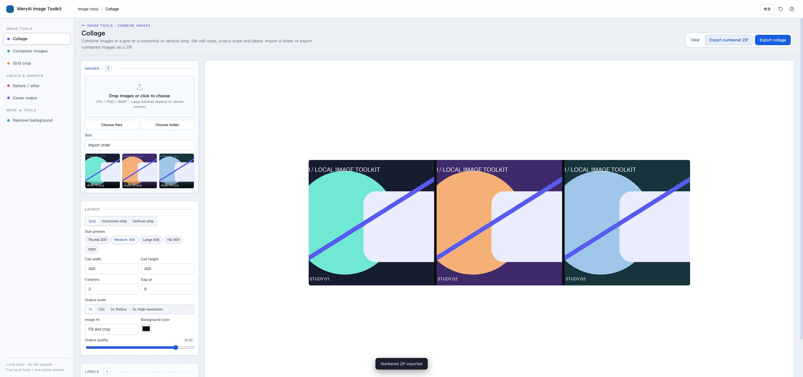
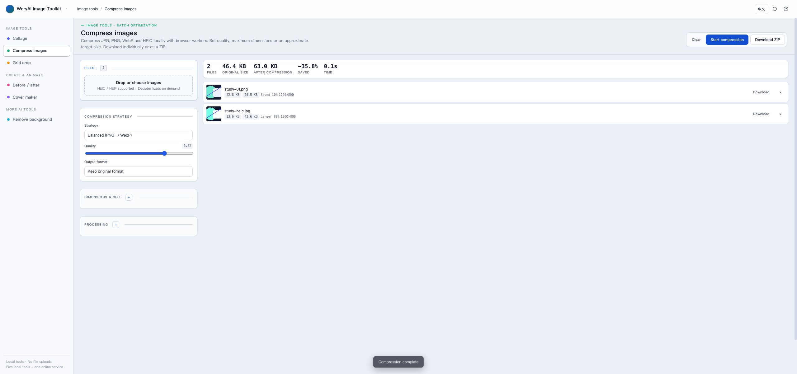
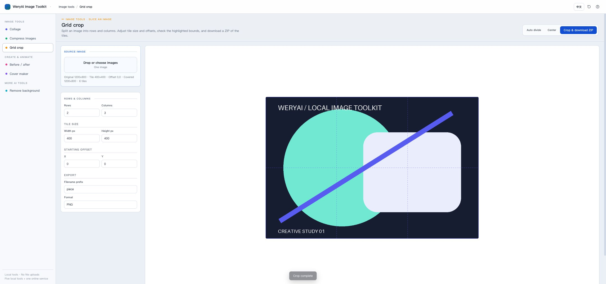
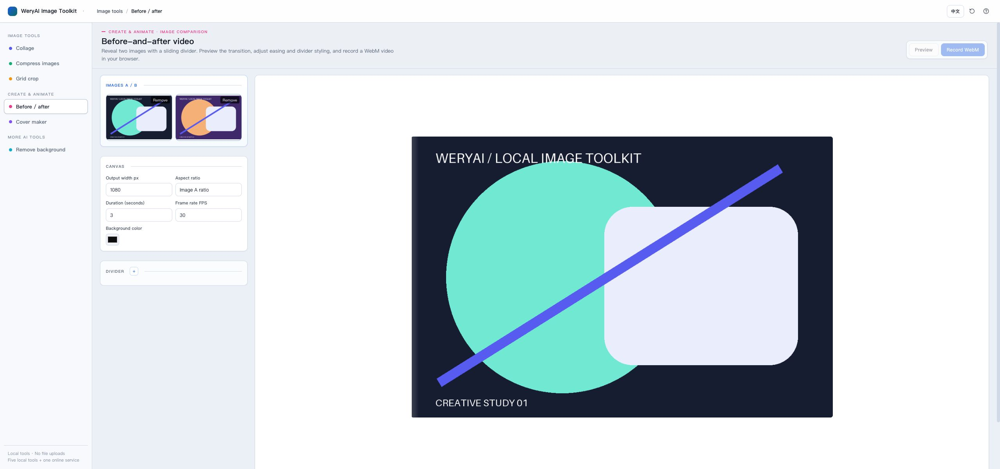
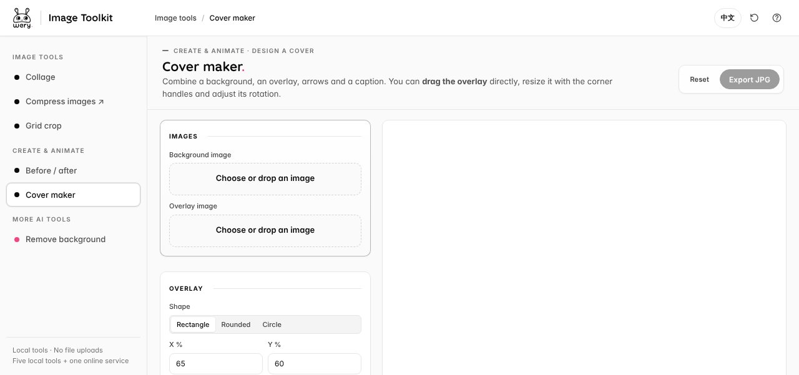
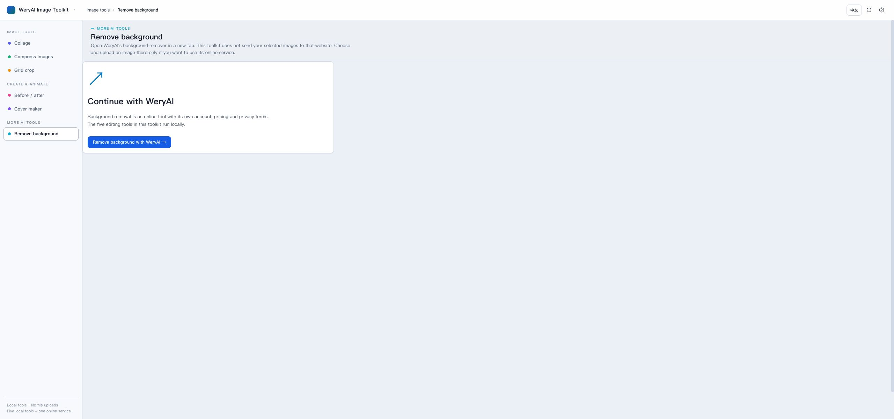

# WeryAI Image Toolkit

Free, private image tools that run in your browser. No account or image uploads for the five local editors.

**[Open the live toolkit →](https://weryaiexpertteam.github.io/browser-image-toolkit/)** · [简体中文](README.zh-CN.md)



## Features

- **Collage:** grids, horizontal/vertical strips, filename/number labels and numbered ZIP export.
- **Compress:** JPG, PNG, WebP and HEIC/HEIF conversion; quality, dimensions and approximate target-size controls, browser workers and ZIP downloads.
- **Grid crop:** divide an image into rows and columns, adjust offsets and export numbered tiles.
- **Before/after video:** sliding image comparison, easing and divider controls; export WebM.
- **Cover maker:** combine a background, draggable overlay, arrows and a caption; export JPG.
- **Background removal:** an optional link to WeryAI's separate online service. Selected images are never passed to it automatically.

<details>
<summary>See all six tools</summary>







</details>

English by default, with a Chinese toggle in the top-right corner. Use a current desktop Chrome or Edge for all export features; browser support for WebM, canvas and HEIC files varies.

## Privacy

Images selected in the five local editors stay in your browser. There is no image-upload endpoint, analytics or account requirement in this toolkit. Selected files are not persisted after closing the page. Only your language and last tool preference are stored locally.

JSZip is included locally. The first HEIC/HEIF import downloads the pinned heic2any 0.0.4 decoder **code** from jsDelivr; it does not upload your image. HEIC conversion therefore needs an internet connection and may not support every HEIC variant. The other tools do not need a remote library download.

Clicking a WeryAI link opens a separate website with its own privacy terms, account requirements and pricing. You choose whether to upload an image there.

## Run locally

Download or clone this repository and open **index.html** in a browser. No build step, server or API key is needed. If your browser restricts workers on `file://`, serve the folder locally instead:

```sh
python3 -m http.server 8000 --bind 127.0.0.1
```

Open `http://127.0.0.1:8000/`. Large batches, large canvases and video exports depend on available device memory. Target file size is approximate; some outputs may be larger than their source.

## More AI tools

- [WeryAI — AI tools for creative work](https://www.wery.ai/?utm_source=github)
- [Zeny — AI photo enhancer](https://www.wery.ai/en/@Zeny-Design-AI-Expert-Workspace/ai-photo-enhancer?utm_source=github)
- [Zeny — AI background remover](https://www.wery.ai/en/@Zeny-Design-AI-Expert-Workspace/ai-background-remover?utm_source=github)

## License

Project code: [MIT](LICENSE), copyright WeryAI Limited. Third-party libraries retain their own licenses; see [THIRD_PARTY_NOTICES.md](THIRD_PARTY_NOTICES.md), including the HEIC decoder's LGPL components.
