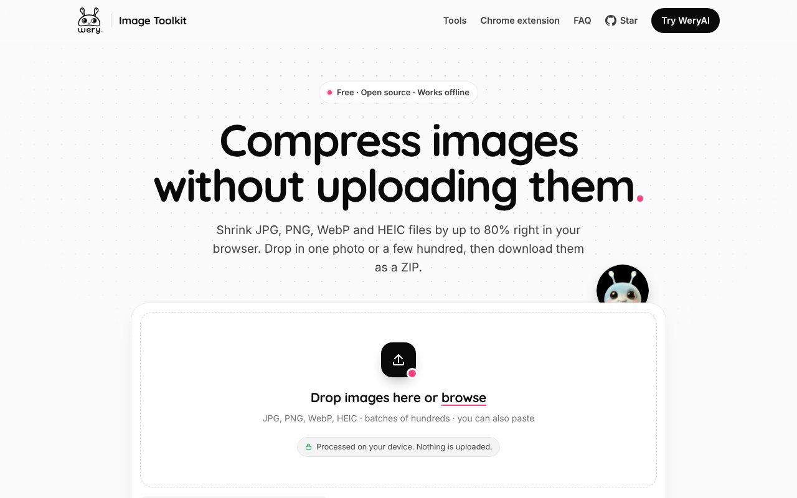

# WeryAI Image Toolkit

Free, private image tools that run in your browser. No account, no uploads.

**[Compress images now →](https://weryaiexpertteam.github.io/browser-image-toolkit/)** · [All tools](https://weryaiexpertteam.github.io/browser-image-toolkit/tools.html) · [Chrome extension](extension/) · [简体中文](README.zh-CN.md)



## Image compressor (home page and Chrome extension)

- Drop, browse or paste JPG, PNG, WebP and HEIC files, one or hundreds at a time; compression starts right away.
- Three levels (High quality / Balanced / Smallest), plus output format, max width/height and a target size in KB.
- **Smart format:** PNGs are tried as WebP and JPEG and the smallest wins; transparency is kept.
- **Never bigger:** if re-encoding would grow a file, the original is kept and marked "Already optimized".
- Parallel Web Workers; download one by one or as a ZIP.
- The same engine ships as a Chrome extension with a right-click **Compress image** menu. See [extension/README.md](extension/README.md).

## More tools ([tools.html](https://weryaiexpertteam.github.io/browser-image-toolkit/tools.html))

- **Collage:** grids, horizontal/vertical strips, filename/number labels and numbered ZIP export.
- **Grid crop:** divide an image into rows and columns, adjust offsets and export numbered tiles.
- **Before/after video:** sliding image comparison, easing and divider controls; export WebM.
- **Cover maker:** combine a background, draggable overlay, arrows and a caption; export JPG.
- **Background removal:** an optional link to WeryAI's separate online service. Selected images are never passed to it automatically.

<details>
<summary>Screenshots</summary>


</details>

The compressor home page is in English. The other-tools page has an English/Chinese toggle in its top-right corner. Use a current desktop Chrome or Edge for all export features; browser support for WebM, canvas and HEIC files varies.

## Privacy

Images selected in the five local editors stay in your browser. There is no image-upload endpoint, analytics or account requirement in this toolkit. Selected files are not persisted after closing the page. Only your language and last tool preference are stored locally.

JSZip is included locally. The first HEIC/HEIF import downloads the pinned heic2any 0.0.4 decoder **code** from jsDelivr; it does not upload your image. HEIC conversion therefore needs an internet connection and may not support every HEIC variant. The other tools do not need a remote library download.

Clicking a WeryAI link opens a separate website with its own privacy terms, account requirements and pricing. You choose whether to upload an image there.

## Run locally

Download or clone this repository and open **index.html** (compressor) or **tools.html** (other tools) in a browser. No build step, server or API key is needed. If your browser restricts workers on `file://`, serve the folder locally instead:

```sh
python3 -m http.server 8000 --bind 127.0.0.1
```

Open `http://127.0.0.1:8000/`. Large batches, large canvases and video exports depend on available device memory. Target file size is approximate: the compressor lowers quality first, then dimensions, and marks results that still exceed the target. If re-encoding, resizing or HEIC conversion would grow the original file, the original is returned; requested changes may be skipped to keep that guarantee.

## Project layout

```
index.html            compressor landing page
tools.html            collage, grid crop, before/after, cover maker
assets/compress-*.js  compression engine (shared with the extension)
assets/compressor.*   compressor UI (shared with the extension)
extension/            Chrome extension (Manifest V3)
scripts/build-extension.sh   copies shared files into extension/ and zips it
```

## More AI tools

- [WeryAI — AI tools for creative work](https://www.wery.ai/?utm_source=github)
- [Zeny — AI photo enhancer](https://www.wery.ai/en/@Zeny-Design-AI-Expert-Workspace/ai-photo-enhancer?utm_source=github)
- [Zeny — AI background remover](https://www.wery.ai/en/@Zeny-Design-AI-Expert-Workspace/ai-background-remover?utm_source=github)

## License

Project code: [MIT](LICENSE), copyright WeryAI Limited. Third-party libraries retain their own licenses; see [THIRD_PARTY_NOTICES.md](THIRD_PARTY_NOTICES.md), including the HEIC decoder's LGPL components. The Quicksand font is under the SIL OFL 1.1. The wery.ai logo, icon and mascot in `assets/brand/` are WeryAI trademarks and are not MIT-licensed.
